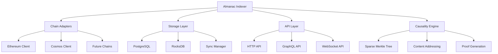
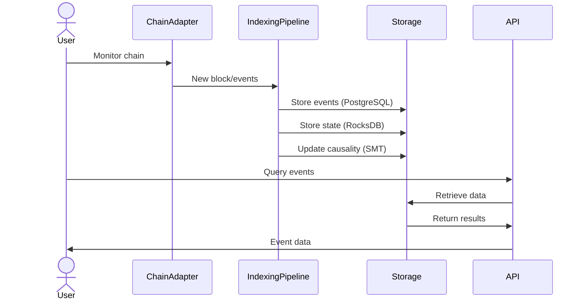
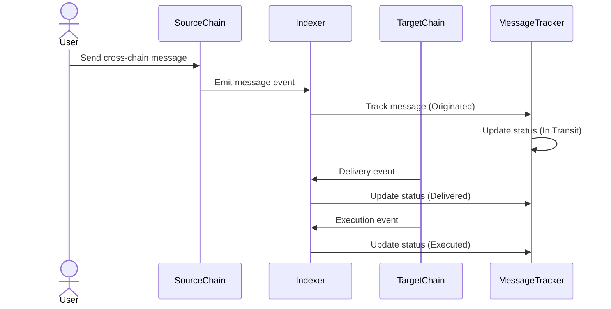
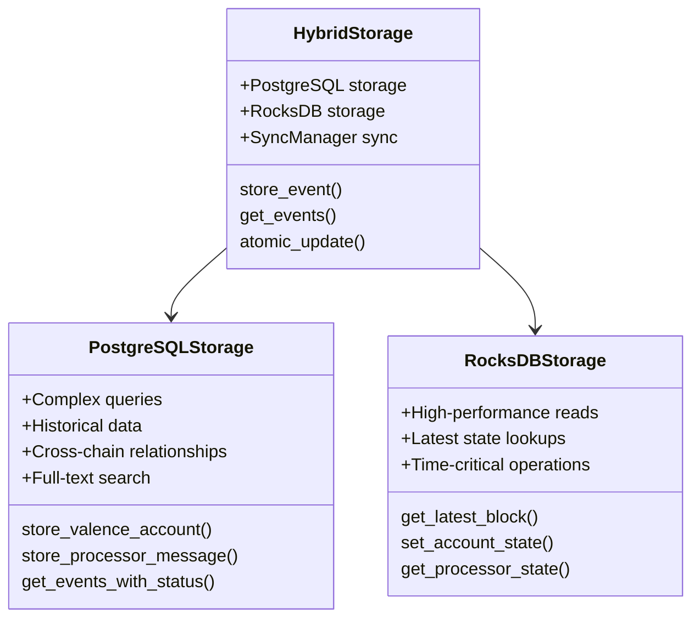
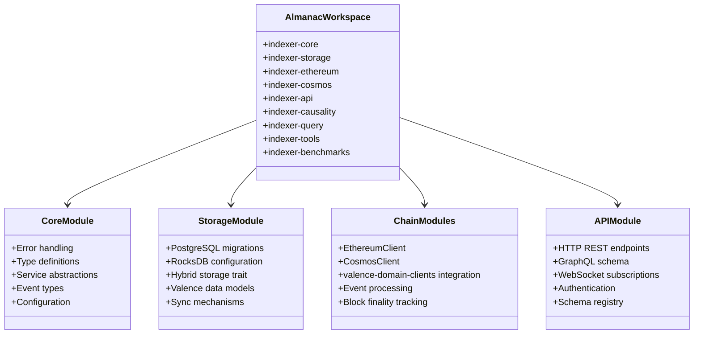

# Almanac Cross-Chain Indexer Architecture

## Overview

The Almanac Cross-Chain Indexer is a production-ready system for tracking contract state and events across multiple blockchain networks. It supports Ethereum and Cosmos chains with a hybrid storage approach optimized for both real-time performance and complex querying.

Key components include a cross-chain indexer service, hybrid storage architecture, comprehensive APIs, Nix-based development environment, and causality indexing with Sparse Merkle Tree implementation.

## System Requirements

### Target Users

- **Strategists and Relayers**: Real-time chain state access with minimal latency
- **Frontend Applications**: Rich querying for historical data and cross-chain state  
- **Protocol Developers**: Contract state visibility and cross-chain interaction monitoring
- **System Administrators**: Monitoring and diagnostic capabilities

### Performance Targets

- Block processing latency: < 500ms
- Event indexing latency: < 1 second from block finality
- Query performance: < 50ms (RocksDB), < 500ms (PostgreSQL)
- Concurrent operations: 100+ concurrent read queries

## Component Architecture

### Chain Adapters

Blockchain-specific adapters handle network communication through specialized clients. Ethereum clients connect to RPC endpoints for Ethereum, Polygon, and Base networks. Cosmos clients integrate with SDK chains and CosmWasm contracts for Noble, Osmosis, and Neutron. Valence domain clients provide optimized adapters for Valence protocol contracts.

### Event Processing Pipeline

The processing pipeline ensures reliable data ingestion through event capture from blockchain nodes, batch processing with retry mechanisms, validation of data integrity and state transitions, and atomic storage operations across both storage systems.

### API Layer

Multiple interfaces serve different use cases: GraphQL for complex queries with relationships, REST for simple HTTP endpoints, and WebSocket for real-time event subscriptions.

## Data Flow

### Event Indexing Workflow

### Cross-Chain Message Tracking

## Storage Architecture

The hybrid storage architecture combines PostgreSQL and RocksDB for optimal performance across different query patterns while maintaining data consistency.

### Hybrid Storage Design

### RocksDB Layer

Handles performance-optimized operations including latest state lookups, real-time event streams, and time-critical queries. Uses LSM-Tree optimization for write-heavy workloads with 64MB write buffers, direct I/O, LZ4 compression, and bloom filters for optimal performance.

### PostgreSQL Layer

Provides complex relational queries, historical data analysis, and cross-chain relationships through normalized table structures with strategic indexing. Supports full-text search and JSON columns for flexible schema-less data.

### Synchronization Mechanism

A transaction coordinator ensures atomic consistency between storage systems, validating operations succeed in both stores before committing changes. Includes rollback capabilities and automatic recovery mechanisms.

## Block Finality Tracking

The indexer tracks multiple finality levels for appropriate security guarantees:

**Ethereum**: Confirmed (may be reorganized), Safe (unlikely to be orphaned), Justified (validator voted), Finalized (irreversible)

**Cosmos**: Committed (consensus validated), Final (chain-specific finality rules)

The system polls blockchain nodes for finality status and updates the database so applications can choose appropriate security levels.

## Valence Protocol Integration

### Contract Architecture

### Contract Types

**Valence Accounts**: Track creation, ownership transitions, library approvals, and execution history with comprehensive audit trails.

**Valence Processor**: Monitor processor state, cross-chain message processing, upgrades, and configuration changes with full lifecycle tracking.

**Valence Authorization**: Manage authorization grants, revocations, policy changes, and enforcement with audit trails for security analysis.

**Valence Libraries**: Track deployments, version upgrades, and usage patterns with dependency analysis for security implications.

## Security and Performance

### Security Measures

- Cryptographic verification of block headers and transaction data
- State validation ensuring contract transitions follow protocol rules
- JWT-based authentication with rate limiting and input validation
- Chain reorganization handling with atomic rollback and re-indexing

### Performance Characteristics

Performance benchmarks demonstrate hybrid approach advantages:

| Operation Type | RocksDB (ms) | PostgreSQL (ms) | Used Backend |
|----------------|--------------|-----------------|--------------|
| Latest Block Query | 1.2 | 8.7 | RocksDB |
| Account State Lookup | 0.9 | 6.4 | RocksDB |
| Cross-Chain Analysis | 15.3 | 3.8 | PostgreSQL |
| Event Filtering (simple) | 2.5 | 11.2 | RocksDB |
| Event Filtering (complex) | 36.8 | 7.5 | PostgreSQL |

### Scaling Capabilities

Supports 100+ concurrent queries with efficient RocksDB cache utilization, optimized storage patterns, and efficient serialization. Architecture supports horizontal scaling through PostgreSQL read replicas, RocksDB sharding, and distributed query processing.

## Development and Operations

### Configuration Management

Uses Nix-based environment setup, TOML configuration files with hot-reload support, and environment variable overrides for deployment flexibility.

### Module Structure

### Monitoring and Testing

Includes component-level health monitoring, Prometheus-compatible metrics, structured logging with correlation IDs, and comprehensive testing framework with integration tests, property-based tests, performance tests, and chaos engineering.

## Causality and Cross-Chain Features

### Causality Tracking

Provides Sparse Merkle Trees for cryptographic proof generation, event correlation across chains, and comprehensive cross-chain message tracking.

### Content-Addressed Resources

Enables content hash-based entity identification, cryptographic proof generation and verification, and cross-chain program state representation for advanced debugging and compliance.

## Current Status and Future Extensions

### Implementation Status

Production-ready with hybrid PostgreSQL/RocksDB storage, robust Ethereum and Cosmos integration, complete Valence protocol support, full API coverage, advanced causality tracking, and comprehensive Nix-based development environment. All performance targets are met.

### Future Enhancements

Planned expansions include Layer 2 solutions, Solana integration, Move-based chains, advanced analytics, enhanced causality features with zero-knowledge integration, and horizontal scaling capabilities.

The Almanac Cross-Chain Indexer provides high-performance tracking of contract state across multiple blockchain networks with a robust foundation for future growth and ecosystem support. 